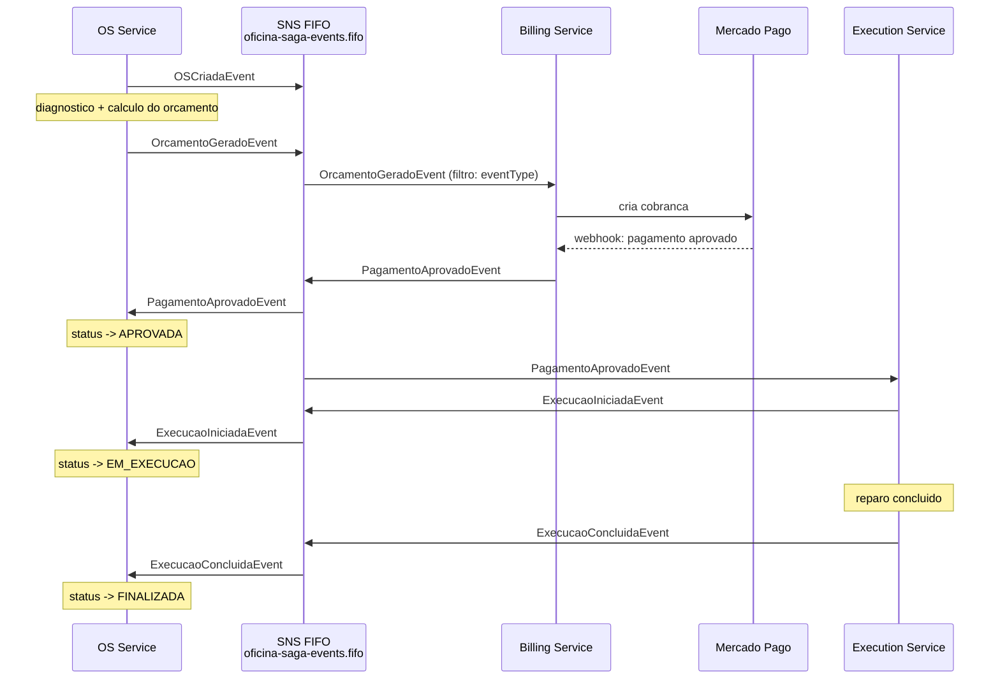
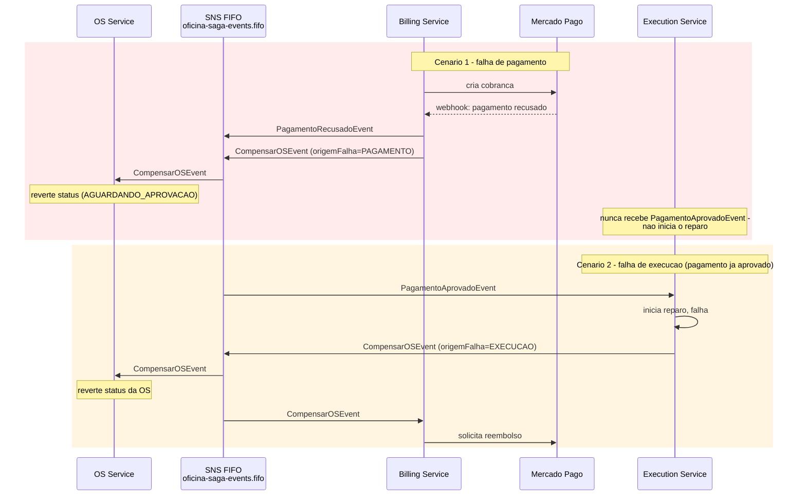

# Saga Pattern — Fase 4

## Contexto

A Fase 4 decompõe o monolito `oficina-app` em 3 microsserviços:

| Serviço | Responsabilidade |
|---|---|
| **OS Service** | Ordem de Serviço: cadastro, diagnóstico, cálculo de orçamento, status |
| **Billing Service** | Orçamento/pagamento, integração com Mercado Pago |
| **Execution Service** | Fila de produção e execução dos reparos |

Uma transação que hoje é local (tudo dentro de uma única `OrdemServico` no
monolito) passa a ser distribuída entre 3 serviços independentes, cada um
com seu próprio banco de dados. Um Saga Pattern coordena essa transação
distribuída, garantindo consistência eventual e definindo como desfazer
(compensar) o que já foi feito caso uma etapa falhe no meio do caminho.

## Escolha: Saga Coreografado (Choreography-based)

**Decisão**: coreografado, não orquestrado. Cada serviço publica um evento
ao concluir sua etapa e reage a eventos publicados por outros serviços —
não existe um 4º serviço orquestrador central dando ordens.

**Justificativa**:
1. O fluxo é majoritariamente linear, com um único ponto de ramificação real
   (pagamento aprovado vs. recusado). Não há lógica de coordenação complexa
   (paralelismo, múltiplos caminhos concorrentes) que justifique o custo e
   a complexidade adicional de um orquestrador dedicado.
2. O projeto já tem precedente de arquitetura event-driven desde a Fase 3
   (a Lambda de autenticação reage a uma requisição HTTP sem coordenador
   central).
3. Acoplamento mínimo: cada serviço só precisa conhecer o **contrato** dos
   eventos que publica/consome (ver `oficina-messaging-infra/contracts/`),
   nunca a implementação interna dos outros serviços.

**Trade-off aceito**: em um Saga orquestrado, o estado da transação fica
centralizado e visível num único lugar (o orquestrador), facilitando
auditoria. No coreografado, o estado da saga está implicitamente distribuído
entre os 3 serviços — a tabela `OrdemServicoStatusHistorico` (já existente
desde a Fase 3) continua sendo a fonte de verdade para reconstruir o
histórico de uma saga específica a partir do `correlationId`
(`ordemServicoId`).

## Infraestrutura de mensageria

Provisionada em [`oficina-messaging-infra`](https://github.com/marcosrenansilvafaria-afk/oficina-messaging-infra)
(Terraform): 1 tópico SNS FIFO (`oficina-saga-events.fifo`) + 1 fila SQS
FIFO/DLQ por serviço consumidor, com *filter policies* por `eventType`. AWS
SNS/SQS (serverless) foi escolhido em vez de um broker próprio (RabbitMQ no
K8s) para não reintroduzir custo fixo de cluster — ver
[RFC-004](rfc/RFC-004-saga-pattern-mensageria.md) para a decisão completa.

## Fluxo feliz (Happy Path)



1. **OS Service** cria a OS → publica `OSCriadaEvent`.
2. **OS Service** conclui o diagnóstico e calcula o orçamento → publica
   `OrcamentoGeradoEvent`.
3. **Billing Service** consome `OrcamentoGeradoEvent` → cria a cobrança no
   Mercado Pago → aguarda o webhook de confirmação.
4. **Billing Service** recebe a confirmação → publica
   `PagamentoAprovadoEvent`.
5. **OS Service** consome `PagamentoAprovadoEvent` → status → `APROVADA`.
6. **Execution Service** consome `PagamentoAprovadoEvent` → entra na fila de
   produção, inicia o reparo → publica `ExecucaoIniciadaEvent`.
7. **OS Service** consome `ExecucaoIniciadaEvent` → status → `EM_EXECUCAO`.
8. **Execution Service** conclui o reparo → publica
   `ExecucaoConcluidaEvent`.
9. **OS Service** consome `ExecucaoConcluidaEvent` → status →
   `FINALIZADA`.

## Fluxos de compensação (rollback)



### Cenário 1 — Falha de pagamento

O Mercado Pago recusa ou expira a cobrança. **Billing Service** publica
`PagamentoRecusadoEvent` (para fins de auditoria/histórico) **e**
`CompensarOSEvent` (`origemFalha: "PAGAMENTO"`). **OS Service** consome
`CompensarOSEvent` e reverte a OS para um estado anterior a aprovação (ex.
volta para `AGUARDANDO_APROVACAO`, permitindo um novo ciclo de
orçamento/cobrança). O **Execution Service** nunca chega a ser acionado,
porque só reage a `PagamentoAprovadoEvent` — que neste cenário nunca é
publicado.

### Cenário 2 — Falha de execução

O pagamento já foi aprovado e o reparo já havia começado, mas falha (ex:
peça incompatível, impossibilidade técnica). **Execution Service** publica
`CompensarOSEvent` (`origemFalha: "EXECUCAO"`) **em vez de**
`ExecucaoConcluidaEvent`. Dois consumidores reagem:
- **OS Service**: reverte o status da OS.
- **Billing Service**: como o pagamento já havia sido aprovado, inicia o
  **reembolso** no Mercado Pago — compensação financeira real, não apenas
  uma reversão de estado.

`CompensarOSEvent` é desenhado como o **evento de compensação genérico**: o
campo `origemFalha` deixa explícito qual etapa falhou, mas qualquer serviço
que precise reagir a uma falha (seja ela qual for) escuta o mesmo evento —
evita que cada serviço precise conhecer todos os tipos de falha possíveis
dos outros serviços.

## Contratos de evento

Definidos em [`oficina-messaging-infra/contracts/`](https://github.com/marcosrenansilvafaria-afk/oficina-messaging-infra/tree/main/contracts)
(interfaces TypeScript + JSON Schema draft-07). Todos os eventos usam o
mesmo envelope:

```ts
interface SagaEventEnvelope<TPayload> {
  eventId: string;       // uuid v4 - tambem usado como MessageDeduplicationId
  eventType: string;     // ex: "OSCriadaEvent"
  eventVersion: string;  // "1.0"
  occurredAt: string;    // ISO 8601
  correlationId: string; // = ordemServicoId - tambem usado como MessageGroupId (garante ordem FIFO por OS)
  payload: TPayload;
}
```

| Evento | Publicado por | Consumido por |
|---|---|---|
| `OSCriadaEvent` | OS Service | — (informativo/auditoria) |
| `OrcamentoGeradoEvent` | OS Service | Billing Service |
| `PagamentoAprovadoEvent` | Billing Service | OS Service, Execution Service |
| `PagamentoRecusadoEvent` | Billing Service | — (ver `CompensarOSEvent`) |
| `ExecucaoIniciadaEvent` | Execution Service | OS Service |
| `ExecucaoConcluidaEvent` | Execution Service | OS Service |
| `CompensarOSEvent` | Billing Service ou Execution Service | OS Service, Billing Service, Execution Service (conforme `origemFalha`) |

## Fora do escopo desta sprint

Código dos 3 microsserviços, integração real com o SDK do Mercado Pago,
split do `prisma/schema.prisma` atual, testes BDD/unitários dos novos
serviços, SonarQube — ficam para as próximas sprints da Fase 4.

## Referências

- [RFC-004 — Saga Pattern e infraestrutura de mensageria](rfc/RFC-004-saga-pattern-mensageria.md)
- [`oficina-messaging-infra`](https://github.com/marcosrenansilvafaria-afk/oficina-messaging-infra) — Terraform + contratos
- [`docs/diagram/fase4-saga-happy-path.mmd`](diagram/fase4-saga-happy-path.mmd)
- [`docs/diagram/fase4-saga-compensacao.mmd`](diagram/fase4-saga-compensacao.mmd)
